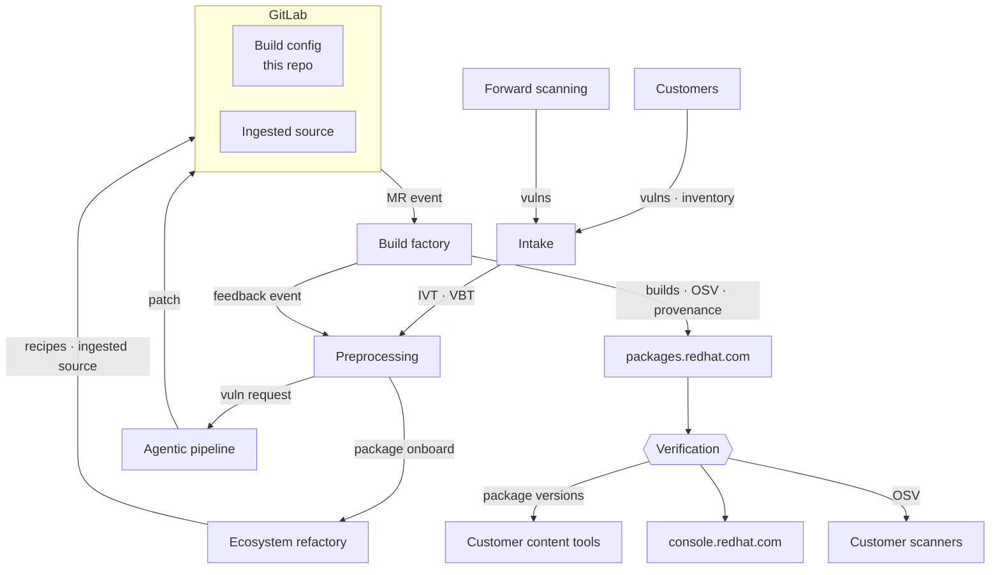
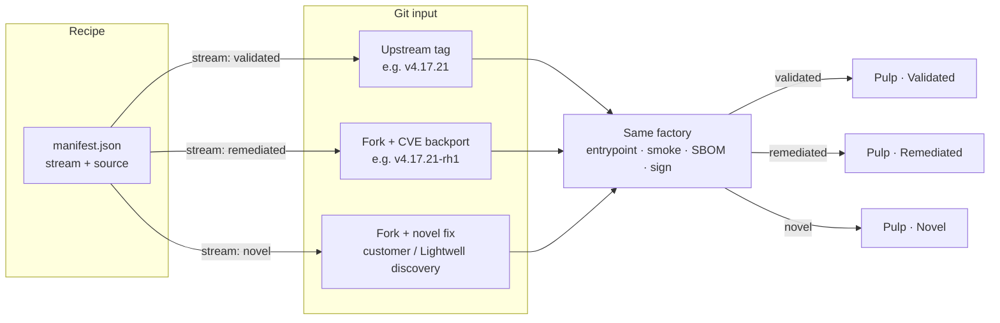

# calunga-javascript architecture


| Field           | Value                                                                                                                                          |
| --------------- | ---------------------------------------------------------------------------------------------------------------------------------------------- |
| **Status**      | Draft                                                                                                                                          |
| **Inspired by** | Calunga npm PoC (`npm-registry` factory + recipe)                                                                                              |
| **Home**        | Lightwell build-configs — sibling of `[calunga-python](https://gitlab.cee.redhat.com/lightwell/lightwell-builds/build-configs/calunga-python)` |


This repository holds **per-package build recipes** for Lightwell’s JavaScript (npm) streams. The factory (Konflux, builder images, release pipelines) builds from **git source**, produces SBOMs and attestations, and publishes to Pulp (`packages.redhat.com`). It does **not** republish tarballs from registry.npmjs.org.

---

## Summary


| Concept                 | Role                                                                                                                                                                                                                    |
| ----------------------- | ----------------------------------------------------------------------------------------------------------------------------------------------------------------------------------------------------------------------- |
| **Lightwell factory**   | Hermetic/controlled build, linux-x64 glibc builders, SBOM, signing, Pulp publish, compliance / closure                                                                                                                  |
| **This repo (recipes)** | Per `name@version`: `manifest.json`, `build.entrypoint.sh`, `verify.smoke.sh` — human-reviewed                                                                                                                          |
| **Streams**             | `validated` (upstream rebuild), `remediated` (fork with CVE backport), `novel` (fix for a vuln Lightwell or customers discovered — not a community backport) — same factory; remediated/novel use separate Pulp targets |
| **Native tiers**        | `A` / `B` / `C` — how many outputs one recipe run must produce                                                                                                                                                          |
| **Dependency closure**  | Graded `L1`–`L3` compliance on published versions; catalog grows without blocking publish                                                                                                                               |


Human review is required on every recipe change. Agents may draft MRs; they do not sign releases or approve policy gates.

---

## Place in the Lightwell pipeline

The **Ecosystem refactory** uses agents to generate **recipes** and to **ingest source** that preprocessing has already verified. Those land in **GitLab** (build config — this repo — beside ingested source), together with any agentic **patch**; a single **MR event** then drives the Build factory.




Feedback events from the Build factory include **new versions** of packages already onboarded, **dependency-closure blockers** (gaps that keep a published version below L3), and **published** events for a package that **closes a VBT**. Preprocessing creates VBTs for the first two (prioritized alongside customer VBTs from intake) and closes the matching VBT when a publish succeeds.


| Stage                   | What it means for JavaScript                                                                                                                                                                                                                                                                                                                                                                                                                            |
| ----------------------- | ------------------------------------------------------------------------------------------------------------------------------------------------------------------------------------------------------------------------------------------------------------------------------------------------------------------------------------------------------------------------------------------------------------------------------------------------------- |
| **Intake**              | Accepts **vulnerabilities** (customers + forward scanning) and **customer inventory**. Emits **IVTs** (vuln-driven) or **VBTs** (inventory-driven validated builds) into preprocessing. Inventory is the key input for validated coverage.                                                                                                                                                                                                              |
| **Preprocessing**       | Receives **IVT** or **VBT** from intake **and feedback events** from the Build factory. Enriches tickets; creates **VBTs** for feedback (new onboarded-package versions, closure blockers) and prioritizes them with customer VBTs from intake; **closes a VBT** when feedback carries a **published** event for that package. Emits a **vulnerability request** to the agentic pipeline and/or a **package onboard** event to the ecosystem refactory. |
| **Agentic pipeline**    | Handles vulnerability-request events (remediated / novel fixes). Sends a **patch** into **GitLab**.                                                                                                                                                                                                                                                                                                                                                     |
| **Ecosystem refactory** | Handles **package-onboard** events. Runs **agents** that know how to generate **recipes** (manifest, entrypoint, smoke, tier, outputs) and how to **ingest source** that preprocessing has already verified. Writes recipes into **Build config** and verified trees into **Ingested source** under GitLab.                                                                                                                                             |
| **GitLab**              | Holds **Build config** (this repo) beside **Ingested source**. Patch, recipes, and ingested source land here; a merged change emits a single **MR event** into the Build factory.                                                                                                                                                                                                                                                                       |
| **Build factory**       | Consumes the MR event; builds; emits builds, OSV, provenance; sends **feedback events** back to preprocessing (new versions, closure blockers, and **published** events that close VBTs).                                                                                                                                                                                                                                                               |
| **packages.redhat.com** | Distribution hub; consumers resolve package versions (and OSV) after a final verification gate.                                                                                                                                                                                                                                                                                                                                                         |


**Validated** path: customer **inventory** → intake **VBT** → preprocessing (verify) → **package onboard** → ecosystem refactory agents (**recipes** + **ingested source**) → GitLab → **MR event** → Build factory → Validated Pulp.  
**Remediated** path: vulns → intake **IVT** → preprocessing → **vuln request** → agentic **patch** + refactory **recipes** / source → GitLab → **MR event** → Build factory → Remediated Pulp.  
**Novel** path: Lightwell/customer-discovered vulns → intake **IVT** → preprocessing → **vuln request** → agentic **patch** + refactory **recipes** / source → GitLab → **MR event** → Build factory → Novel Pulp.

---

## Streams: `validated`, `remediated`, `novel`

All streams share the same factory, builder images, SBOM, signing, and upload task. Release **routes by `stream`** to different Pulp repositories.




| Manifest `stream` | What it is                                                                                               | Source                                                   | Publish identity                       | Pulp                                                    |
| ----------------- | -------------------------------------------------------------------------------------------------------- | -------------------------------------------------------- | -------------------------------------- | ------------------------------------------------------- |
| `validated`       | Rebuild community release as-shipped                                                                     | Ingested source in GitLab (mirrored from the community release) | Matches community `name@version`       | Lightwell javascript **validated**                      |
| `remediated`      | Apply a **known** upstream/CVE fix onto an older line                                                    | Fork where the **backport** lives                        | Product decision (same semver vs bump) | Separate **remediated** repo (wired when recipes exist) |
| `novel`           | Fix a vulnerability **discovered by Lightwell or customers** (not taking an existing community backport) | Fork where the **novel** fix lives                       | Product decision (same semver vs bump) | Separate **novel** repo (wired when recipes exist)      |


**Remediated vs novel:** same recipe shape and a dedicated Pulp target, but different origin of the fix. Remediated ports a fix that already exists in the community/CVE stream onto a line customers still run. Novel is original remediation work for a vuln Lightwell found for customers, or that customers reported through intake — there is no upstream backport to reuse as the patch source of truth.

Validated versions are **immutable** once released. Recipe fixes onboard a new directory or follow rebuild policy — do not silently overwrite Validated bytes.

---

## Recipe structure

Every onboarded **name@version** is a directory:

```text
packages/<name>/<version>/
  manifest.json           # required — identity, stream, tier, source, outputs
  build.entrypoint.sh     # required — factory invokes; writes only to OUT_DIR
  verify.smoke.sh         # required — post-build checks
  evidence.md             # optional — onboarding notes
  tl-install.js           # optional — Tier B/C install shim copied into the tarball
```

### One manifest, one build, multiple outputs

A single directory = **one** factory run:

- One checkout of `source.ref`
- One entrypoint + one smoke script
- One or more `outputs[]` (Tier A: main only; Tier B/C: main + linux-x64 platform package)

Do **not** split Tier B/C across two MRs. The entrypoint must produce **all** declared outputs before publish.

### Conventions

- **Immutable after merge:** do not rewrite a landed `packages/<name>/<version>/`; onboard the next version instead.
- **No registry republish:** build from git `source.ref`; `upstream_npm` is for audit / comparison, not build input.
- **Lint:** `./hack/lint-manifest.sh` (changed manifests vs `origin/main`); schema at `[manifest.schema.json](manifest.schema.json)`.

### `manifest.json` (Tier B example)

```json
{
  "name": "esbuild",
  "version": "0.28.0",
  "description": "JavaScript bundler — linux-x64 binary + JS wrapper",
  "stream": "validated",
  "native_tier": "B",
  "source": {
    "url": "https://github.com/evanw/esbuild.git",
    "ref": "v0.28.0",
    "ref_type": "tag"
  },
  "upstream_npm": {
    "version": "0.28.0",
    "integrity": "sha512-..."
  },
  "entrypoint": "build.entrypoint.sh",
  "smoke": "verify.smoke.sh",
  "outputs": [
    {
      "id": "main",
      "type": "npm-package",
      "path": "out/esbuild-0.28.0.tgz",
      "pulp_name": "esbuild"
    },
    {
      "id": "linux-x64-binary",
      "type": "tl-platform-package",
      "path": "out/@lightwell/esbuild-linux-x64-0.28.0.tgz",
      "pulp_name": "@lightwell/esbuild-linux-x64",
      "platform": "linux-x64",
      "libc": "glibc"
    }
  ],
  "optional_dependencies_published": [
    "@lightwell/esbuild-linux-x64@0.28.0"
  ]
}
```

Do **not** put `compliance_level`, `missing_gaps`, or `pending_l3_gaps` in the manifest. The pipeline computes those after build.

### Entrypoint and smoke


| Script                | Contract                                                                                                                     |
| --------------------- | ---------------------------------------------------------------------------------------------------------------------------- |
| `build.entrypoint.sh` | Honors `MANIFEST_PATH`, `OUT_DIR`, `WORK_DIR`. Clones/builds from `source.ref` only. Emits every path listed in `outputs[]`. |
| `verify.smoke.sh`     | Runs after a successful entrypoint. Exercises main (and platform) install/runtime enough to catch broken packaging.          |


Tier B/C may ship a small install shim (e.g. `tl-install.js`) that the entrypoint copies into the published main package so `optionalDependencies` resolve the Lightwell platform package — keep the shim visible in the MR diff.

---

## Native tiers


| Tier  | Meaning                                                                   | Outputs                                                 |
| ----- | ------------------------------------------------------------------------- | ------------------------------------------------------- |
| **A** | Pure JS; no native compile / no platform package                          | One `npm-package`                                       |
| **B** | Platform optional family (prebuilt or fetched binary reshaped in-factory) | Main + `tl-platform-package` (linux-x64 glibc)          |
| **C** | Compile-heavy (e.g. node-gyp) in the factory                              | Main + `tl-platform-package`; stricter smoke and review |


v1 platform: **linux-x64**, **glibc** (UBI), one Node LTS line per builder image. Platform packages publish under `@lightwell/<name>-linux-x64` (same version as main).

---

## Dependency closure (L1, L2, L3)

Compliance describes **where production dependencies may resolve at install time** for consumers of this `name@version`. It does **not** block publish. Stricter environments may require a minimum level.

**Always true at every level:** this version’s own artifacts (main and, for B/C, `@lightwell/…-linux-x64`) were **built from `source.ref`** — never repacked from npmjs.


| Level  | Name              | Production deps at install                                                          | Typical use                    |
| ------ | ----------------- | ----------------------------------------------------------------------------------- | ------------------------------ |
| **L1** | `partial-closure` | Mixed — missing deps may resolve from upstream npm                                  | Early onboarding; leaves first |
| **L2** | `direct-closure`  | Direct packed `dependencies` available on Lightwell; transitive may still use npmjs | Most packages before full tree |
| **L3** | `full-closure`    | Entire production closure resolves only from Lightwell (linux-x64 v1)               | Production apps                |


**How the level is computed (pipeline, not the recipe):**

1. Open the main `.tgz`, read packed `package.json` `dependencies` (not `devDependencies` / `peerDependencies`). Same-recipe platform optionals count as satisfied.
2. Query the Lightwell javascript registry for each name + range.
3. Write compliance sidecars (`compliance_level`, `direct_dependencies`, `missing_gaps`, `pending_l3_gaps`, …) **next to** the tarball — not inside the consumer package.
4. Release publishes compliance OCI + Pulp labels and runs closure update so waiters advance when blockers land (e.g. L2 → L3) without republishing every parent tarball.


| Level  | Sidecar rule (schema v3)                          |
| ------ | ------------------------------------------------- |
| **L1** | `missing_gaps` non-empty                          |
| **L2** | `missing_gaps` empty, `pending_l3_gaps` non-empty |
| **L3** | both gap lists empty                              |


v1 assess uses **direct** packed dependencies; true full-lockfile L3 is a later tightening.

**Growth strategy:** onboard leaves first (often L3 with no packed deps). Parents may ship at L1/L2; a **global closure index** maps blockers → waiters so landing a dependency refreshes compliance without scanning the whole catalog.

---

## Schema and lint

| Artifact | Path |
| -------- | ---- |
| JSON Schema | [`docs/manifest.schema.json`](manifest.schema.json) |
| Policy lint (CI / local) | [`hack/lint-manifest.sh`](../hack/lint-manifest.sh) |

```bash
# Changed manifests vs origin/main
./hack/lint-manifest.sh

# Full schema check (requires check-jsonschema)
check-jsonschema --schemafile docs/manifest.schema.json packages/*/*/manifest.json
```
